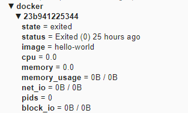
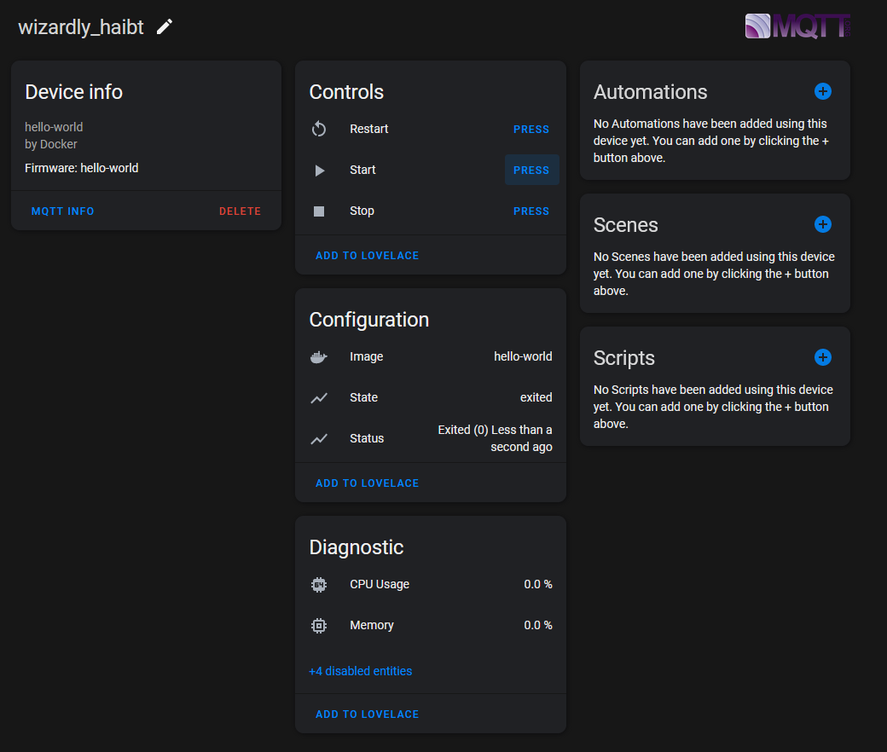

# docker2mqtt - Deliver docker status information over MQTT.

This program uses `docker events` to watch for changes in your docker containers, and delivers current status to MQTT. It will also publish Home Assistant MQTT Discovery messages so that container sensors and controls automatically show up in Home Assistant.

## Features

- Stable Home Assistant devices and entity IDs based on the Docker container name rather than the container ID.
- Recreating a container with the same name updates the existing Home Assistant device instead of creating a duplicate.
- Start, stop and restart buttons control the current container ID behind the stable MQTT topic.
- Removes retained Home Assistant discovery and state topics created by older ID-based versions during migration.
- Reports the container's writable-layer size, making it easy to spot containers that are unexpectedly consuming disk space.

# Running

Use docker to launch this. Please note that you must give it access to your docker socket, which is typically located at `/var/run/docker.sock`. A typical invocation is:

    docker run --network mqtt -e MQTT_HOST=mosquitto -v /var/run/docker.sock:/var/run/docker.sock ghcr.io/denizenn/docker2mqtt

You can also use docker compose:
```yaml
version: '3'
services:
  docker2mqtt:
    container_name: docker2mqtt
    image: ghcr.io/denizenn/docker2mqtt
    environment:
    - LOG_LEVEL=INFO
    - MQTT_DEBUG=0
    - DOCKER2MQTT_HOSTNAME=my_docker_host
    - HOMEASSISTANT_PREFIX=homeassistant
    - MQTT_CLIENT_ID=docker2mqtt
    - MQTT_HOST=mosquitto
    - MQTT_PORT=1883
    - MQTT_USER=username
    - MQTT_PASSWD=password
    - MQTT_TIMEOUT=30
    - MQTT_TOPIC_PREFIX=docker
    - MQTT_QOS=1
    - STATS_DELAY=5
    - PUBLISH_REFRESH=120
    # - DOCKER2MQTT_INCLUDE=web*,db
    # - DOCKER2MQTT_EXCLUDE=watchtower
    restart: always
    volumes:
    - type: volume
      source: /var/run/docker.sock
      target: /var/run/docker.sock
```

# Configuration

You can use environment variables to control the behavior.

| Variable                  | Default            | Description                                                                                                           |
|---------------------------|--------------------|-----------------------------------------------------------------------------------------------------------------------|
| `LOG_LEVEL`               | `INFO`             | One of `DEBUG`, `INFO`, `WARNING`, `ERROR`. (The old `DEBUG=1` switch still works and means `DEBUG`.)                  |
| `MQTT_DEBUG`              | 0                  | Set to `1` to log every MQTT message sent and received. Very noisy, needs `LOG_LEVEL=DEBUG`.                          |
| `DOCKER2MQTT_HOSTNAME`    | Container Hostname | The hostname of your docker host. This will be the container's hostname by default, you probably want to override it. |
| `HOMEASSISTANT_PREFIX`    | `homeassistant`    | The prefix for Home Assistant discovery. Must be the same as `discovery_prefix` in your Home Assistant configuration. |
| `MQTT_CLIENT_ID`          | `docker2mqtt`      | The client id to send to the MQTT broker.                                                                             |
| `MQTT_HOST`               | `localhost`        | The MQTT broker to connect to.                                                                                        |
| `MQTT_PORT`               | `1883`             | The port on the broker to connect to.                                                                                 |
| `MQTT_USER`               | ``                 | The user to send to the MQTT broker. Leave unset to disable authentication.                                           |
| `MQTT_PASSWD`             | ``                 | The password to send to the MQTT broker. Leave unset to disable authentication.                                       |
| `MQTT_TIMEOUT`            | `30`               | The timeout for the MQTT connection.                                                                                  |
| `MQTT_TOPIC_PREFIX`       | `ping`             | The MQTT topic prefix. With the default data will be published to `ping/<hostname>`.                                  |
| `MQTT_QOS`                | `1`                | The MQTT QOS level                                                                                                    |
| `STATS_DELAY`             | `5`                | Seconds between the `docker stats` command being ran and reported via MQTT.                                           |
| `PUBLISH_REFRESH`         | `120`              | Values are only published when they change. Unchanged values are re-sent at least this often (seconds) so Home Assistant does not mark them unavailable. |
| `SIZE_UNIT`               | `MB`               | Unit for the container writable layer size sensor: `B`, `KB`, `MB` or `GB`. Home Assistant keeps long-term statistics in this unit, so pick one and keep it. |
| `DOCKER2MQTT_INCLUDE`     |                    | Comma separated container name patterns (`*` and `?` wildcards, case-insensitive). If set, only matching containers are published. |
| `DOCKER2MQTT_EXCLUDE`     |                    | Comma separated container name patterns to ignore. Takes priority over `DOCKER2MQTT_INCLUDE`.                           |
 

## Notes

- **Unique host names:** every instance sharing an MQTT broker needs its own `DOCKER2MQTT_HOSTNAME`. On startup a warning is logged if the broker already shows that name as `online`.
- **Running sensor:** each container has a `Running` binary sensor (on only while the container's Docker state is `running`). The raw Docker state (`running`, `exited`, `paused`, ...) is still published to `docker/<DOCKER_HOST>/<CONTAINER_NAME>/state`. The old `State` text sensor was replaced; delete the unavailable `State` entities in Home Assistant after upgrading.
- **Container size:** the `Writable Layer Size` sensor is published in `SIZE_UNIT` (default MB) with `state_class: measurement`, so Home Assistant records long-term statistics and you can graph trends in the History panel or a statistics graph card. If you are upgrading from the old byte-based sensor, Home Assistant will report a unit change for it under Developer tools -> Statistics; use the fix option there to convert the existing history instead of deleting it. Docker itself only reports sizes to about three significant figures, so small changes will not show.
- **Traffic:** only changed values are published, so a quiet host sends very little. `1_cpu` is rounded to 2 decimals.

# Consuming The Data

Data is published to various topics of the style `docker/<DOCKER_HOST>/<CONTAINER_NAME>/<container_stat>`. The host is `DOCKER2MQTT_HOSTNAME` and the container name is normalized for use in MQTT topics, so multiple docker2mqtt instances can share one MQTT broker without colliding. Home Assistant discovery topics are likewise scoped per host (`homeassistant/<component>/d2m-<DOCKER_HOST>-<CONTAINER_NAME>/<entity>/config`). Each instance only cleans up its own retained discovery messages. **Set a unique `DOCKER2MQTT_HOSTNAME` on every instance.** The container name is deliberately used instead of the Docker container ID because Docker IDs change when a container is recreated.

The `size` topic reports the writable layer size in bytes. This is the space written by the container itself and does not include the image's shared read-only layers.



# Home Assistant

After you start the service, devices should show up in Home Assistant immediately. Look for devices with Manufacturer `Docker`.
All the metadata, stats and controls for each container are entities in the device.

### Container recreation

The Home Assistant device identifier and entity `unique_id` are derived from the Docker host and container name. If Docker Compose recreates a container, the new Docker ID is associated with the existing identity, so Home Assistant does not create `_2`, `_3`, etc. entities.

The application also subscribes to the old ID-based discovery topics on startup and clears retained messages from older releases. This is a one-time migration cleanup; old Docker IDs are not used for new discovery topics.


